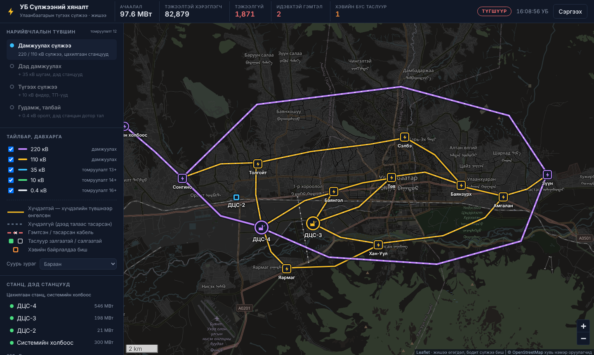
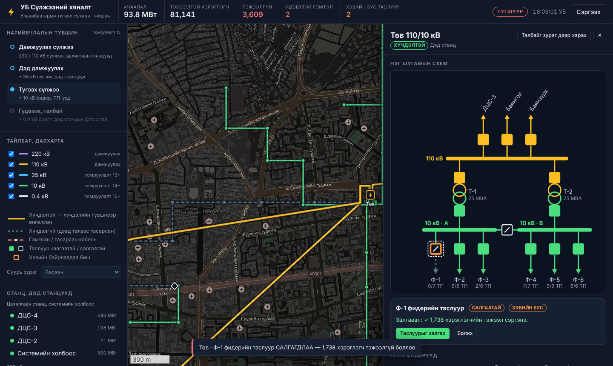

# UB Grid Monitor

Map-based monitoring demo for the Ulaanbaatar electric grid, aimed at field electricians and dispatchers.
Static site: no build step and no backend. The interface is in Mongolian.




## Run

```bash
python3 -m http.server 8000
```

Then open <http://localhost:8000>. Opening `index.html` directly also works. Map tiles need internet access.

## What it shows

| Zoom | Detail level | Visible |
|------|--------------|---------|
| ≤ 12 | Transmission | 220 / 110 kV ring, power plants (CHP-2, CHP-3, CHP-4), central-grid tie |
| 13   | Sub-transmission | + 35 kV lines and 35/10 kV substations |
| 14–15 | Distribution | + 10 kV feeders, transformer points (TP), normally-open tie switches |
| 16+  | Street & yard | + 0.4 kV service cables to consumers, and the inside of each substation: busbars, transformers, breakers, each line landing on its own bay |

Line states:

- **Live**: solid, coloured by voltage, with moving dashes in the direction of supply
- **De-energised**: grey dashed (healthy cable, cut off upstream)
- **Faulted / cut**: red dashed with a ✕ marker

## Switching

- Click a station (or a breaker inside its yard on the map) to open its single-line diagram.
- Select a breaker to see how many customers it would drop or restore, then open or close it.
  Everything downstream goes dark on the map immediately.
- Each 10 kV bus has two sections with a normally-open bus coupler, and feeder ends have normally-open
  tie switches, so supply can be restored by back-feeding.
- Click any line to simulate a cable fault or mark it repaired.
- Switches not in their normal position are outlined in orange and counted in the top bar.

## Data

**All network data is synthetic.** Plant and substation positions are approximate, and feeders, transformer
points and consumers are generated procedurally (deterministic seed) in `js/network.js`. To use real data,
replace the `STATIONS` / `LINES` tables and the feeder generator with your GIS/SCADA export; the UI only
depends on the model returned by `Grid.build()`.

## Layout

- `js/network.js` — network model, substation layout, energisation tracing (no DOM; runs under Node)
- `js/app.js` — Leaflet map, zoom-dependent rendering, substation panel, switching
- `css/style.css` — styles
- `vendor/leaflet` — Leaflet 1.9.4 (BSD-2-Clause)
- `test/smoke.js` — model checks: `node test/smoke.js`

Basemap © OpenStreetMap contributors (public tile server, fine for a demo; use your own tile source in production).
